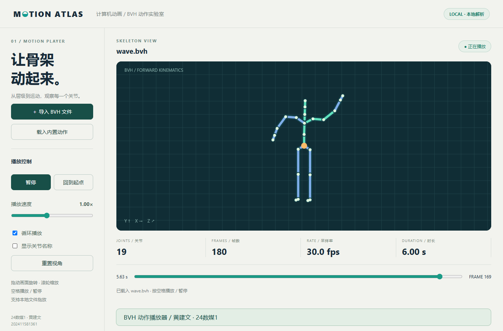

# Motion Atlas · BVH 动作播放器

24数媒1 · 黄建文 · 202411581361

基于 JavaScript、Canvas 2D 三维投影实现的独立动作演示程序，属于题目允许的“其他编程环境”。不需要 Unity、npm 依赖或联网资源。

## 运行

安装 Node.js 22 或更高版本，在本目录运行 `npm start`（或双击 `启动程序.cmd`），用 Chrome / Edge 打开 **http://localhost:8121**。请使用本地服务打开，不能直接双击 HTML。

## 功能与操作

- 自动加载自制 `samples/wave.bvh`：19 个关节、5 个 End Site、180 帧、30 fps。
- 点击“导入 BVH 文件”或将 `.bvh` 拖到页面，读取本地文件。
- 点击“播放 / 暂停”或按空格；“回到起点”重置播放时间。
- 拖动速度滑块选择 0.25～2 倍速；拖动进度条跳到任意时间。
- 可以关闭循环、显示关节名；拖动画面旋转，滚轮缩放，“重置视角”恢复观察角度。
- 显示关节数、总帧数、采样率、时长、当前帧。

## 实现说明

`bvh.js` 解析 HIERARCHY / ROOT / JOINT / End Site、OFFSET、CHANNELS 和 MOTION 数据，保留文件中的旋转通道顺序。每帧先建立局部四元数，使用 SLERP 插值，再沿父子层级计算世界坐标。`app.js` 管理播放时间和相机角度，并将三维骨架投影到 Canvas。

播放时间增量为真实时间 × 倍速。暂停时保持时间不变。非循环播放停在最后一帧；循环播放在最后一帧与首帧之间插值。内置 BVH 是原创程序生成素材，没有使用他人的动作捕捉数据。

## 检验与注意事项

运行 `npm test`：验证父子旋转、根平移、四元数插值、通道顺序、非法数据和循环边界。浏览器实测文件导入、暂停保持、倍速、进度跳转以及视角操作。

支持标准 BVH 文本文件和 X/Y/Z position、rotation 通道；最多 512 节点、1000 万通道数值、20MB 文件。默认 Y 向上、按首帧自动居中，Z 向上的数据需要预先转换轴向。显示的是骨架，不包含蒙皮角色。错误文件会提示原因并保留已有动作。

## 提交

- [代码仓库](https://github.com/1ylmx-h/BVHMotionPlayer)
- [演示视频](DemoVideo/BVHMotionPlayer.mp4)

仓库保存未压缩源文件，入口为 `index.html`，无压缩包或 unitypackage。

## 调研参考

- [Three.js 动画系统](https://threejs.org/manual/#en/animation-system)（调研播放时间与动画结构；本项目自行实现解析和播放）
- [BVHLoader 官方源代码](https://github.com/mrdoob/three.js/blob/r169/examples/jsm/loaders/BVHLoader.js)（调研 BVH 层级及通道顺序）
